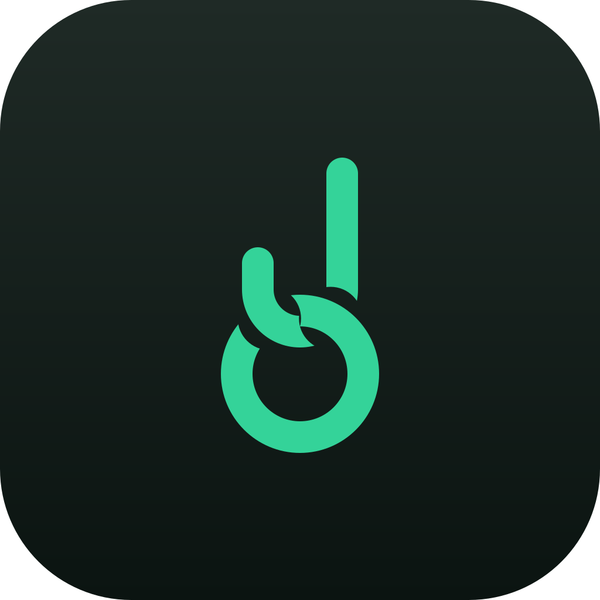

<p align="center"></p>

<h1 align="center">velcro</h1>

Keep network shares stuck to your Mac.

macOS drops SMB mounts whenever Wi‑Fi blips, the lid closes, or you change networks — and then you're back in **Finder → Go → Connect to Server**. velcro watches your shares and quietly remounts them, like iCloud Drive but for your NAS.

- Remounts right after the network changes or your Mac wakes, and on a timer
- No error dialogs — failures go to a log file
- Never touches a share just to check it, so a dead network can't freeze your Mac
- Fallback hosts: try the LAN address first, then Tailscale (or any other route)
- Pause when you want an ejected share to stay ejected
- A menu bar app and a `velcro` command that share the same list
- Uses the password macOS already saved in your Keychain

It also does things that don't need a NAS at all:

- **[Voice recorder import](#import-from-a-voice-recorder):** plug in a USB recorder and its recordings are copied to any folder you choose, checked by SHA-256, then cleared from the recorder
- **[Send to an inbox](#send-to-an-inbox):** save a recent screenshot or file to a folder (a share, Dropbox, Syncthing) and copy its path, even the path a server sees
- **[Mac mic](#lend-your-macs-microphone-to-a-server):** lend your Mac's microphone to a Linux machine you use over SSH, so voice input there (Claude Code's `/voice`) hears you; it's open only while something there records
- **[Mac clipboard](#paste-mac-screenshots-on-a-server):** copy an image on your Mac and ⌃V pastes it into Claude Code on a Linux machine you use over SSH; text and passwords stay on the Mac
- **[Process recordings](#process-recordings):** on a server that sees the recordings folder, transcribe each imported recording and hand it to your own tidy and deliver commands, retrying failures
- **[Transcribe](#transcribe-a-voice-memo):** turn an audio file, like a Slack voice memo, into text with the speech-to-text Claude Code's `/voice` uses, or ChatGPT's through Codex, signed in as you

## Install

**Let your agent do it.** Give Claude Code, Codex, or Cursor this repository (or the setup prompt from **[velcro.dgit.co](https://velcro.dgit.co/#install)**) and ask it to set up velcro. [AGENTS.md](AGENTS.md) walks it through installing, finding the shares you already have mounted, and asking where recordings and sent files should go, before it adds anything.

**Or run it yourself:**

```sh
curl -fsSL https://velcro.dgit.co/install | sh                    # menu bar app + velcro command
curl -fsSL https://velcro.dgit.co/install | sh -s -- --cli-only   # just the command and its LaunchAgents
```

The [installer](site/public/install) checks each download against the SHA-256 in [velcro.dgit.co/latest](https://velcro.dgit.co/latest) before installing anything. Run it again to update. On first launch the app:

- adds itself to Login Items, so shares come back after a restart
- links the `velcro` command to `~/.local/bin/velcro`
- replaces the LaunchAgent and SwiftBar plugin from velcro 0.2, if you had them

**Or download the zip** from [velcro.dgit.co](https://velcro.dgit.co), unzip, and drag **velcro.app** into Applications (see the FAQ for the first launch), or clone this repository and run `./velcro install`.

## Menu bar

| Icon | Meaning |
|---|---|
|  | every share attached |
|  | something dropped — velcro is reattaching |
|  | paused |

The menu groups shared folders by server, each with open in Finder, reconnect, and remove, plus pause/resume, reconnect now, add share, settings, and the log. **Transcribe Audio File…** turns a voice memo into text and copies it (see [Transcribe](#transcribe-a-voice-memo)). Settings edits the list (with fallback hosts), turns login launch on or off, and sets how often velcro checks.

## Command line

```sh
velcro add smb://me@nas.local/home
velcro add "smb://me@nas.local/Media Library"          # spaces are fine
velcro add smb://me@192.168.1.10/photos nas.tail1234.ts.net   # LAN first, then Tailscale
velcro add nfs://nas.local/volume1/backup

velcro status
# agent:  velcro.app (on network change, wake, and a timer)
# state:  active
#
# nas.local
#   ● mounted                  home                   /Volumes/home
#   ○ offline                  backup

velcro pause      # eject in Finder and it stays ejected
velcro resume
velcro logs
velcro rm photos
velcro uninstall
```

The first mount may show the usual macOS login prompt — tick **Remember this password in my keychain** and you won't see it again.

## Import from a voice recorder

Plug in a USB voice recorder and velcro copies its recordings to a folder you choose, checks every copy, then clears the recorder and ejects it. The folder can be on your Mac (`~/Recordings`), an external drive, iCloud Drive, or a NAS; you don't need a NAS or any shares for this.

```sh
velcro recorder add /Volumes/VOICE              # the recorder's volume, plugged in
velcro set import.folder RECORD                  # optional: only its recordings folder
velcro set import.delete no                      # optional: keep recordings on the recorder
velcro set import.dest ~/Recordings             # last: importing starts once this is set
velcro import                                    # or just plug it in next time
velcro import --files meeting.m4a interview.wav    # manually upload files; keep the originals
```

- The recorder is recognized by its volume UUID (`diskutil info`), so another drive with the same name is left alone.
- Each file is copied under a hidden name, read back from the destination, and compared by size and SHA-256. The read-back uses `velcro-sha`, a small tool that reads with the Mac's file cache off; otherwise macOS answers a read of a file it just wrote to a share from its own memory, and the check would never reach the server. The app and the installer include it; a plain `./velcro install` from a clone falls back to `openssl`, which can read from the cache. Only when every file matches are they deleted from the recorder. A file that's already there with the same contents is skipped; a different file with the same name is saved as `name-2.WAV`.
- If the folder is on a drive or share that isn't attached, recordings are verified into `~/Library/Application Support/velcro/import-queue` first, and move there (verified again) when it comes back.
- Every import is appended to `.velcro-import.jsonl` in the folder, one JSON object per file: `file`, `size`, `sha256`, `imported_at`, `device`, `device_uuid`, `original`, `duration_s`. A server can watch it for new recordings and check the hash before using one.
- In the menu: progress next to the icon, **Import Now**, and **Register Recorder** for a drive that's plugged in. Settings has the folder, file types, and switches for importing on plug-in and deleting after verifying.
- **Upload Recordings…** in the menu or Settings lets you select recordings from any folder, without a registered recorder. It uses the same import folder, verification, offline queue and manifest as automatic recorder imports. Selected originals are always kept, even with `import.delete` on; no drive is ejected. `velcro import --files <file ...>` does the same from the command line.

## Send to an inbox

velcro keeps the last few images and files you copied. Pick one under **Send to Inbox** in the menu and it's saved in your inbox folder, and its path is put on the clipboard. Use a folder on a share, or one Dropbox or Syncthing keeps in sync; with a `map` rule, the path is the one another machine (say, a server you use over SSH) sees. velcro never changes the clipboard on its own.

```sh
velcro set send.inbox /Volumes/home/inbox
velcro set map "/Volumes/home -> /mnt/nas/me"    # how the server sees that share
velcro send screenshot.png                       # → /mnt/nas/me/inbox/screenshot.png, copied
velcro send                                      # whatever's on the clipboard
```

Files velcro sent are deleted after 14 days (`velcro set send.keep 30`, or `0` to keep them); anything else in the folder is never touched. The folder is created if missing, but only when its parent exists, so `~/Dropbox/inbox` on a Mac without Dropbox reports an error instead of making a stray `~/Dropbox`. Sending is always your pick in the menu or a `velcro send`; nothing is sent on its own.

## Lend your Mac's microphone to a server

If you run Claude Code (or anything else that listens) on a Linux machine over SSH, its voice input can't hear you: the microphone is on your Mac. velcro can lend it.

```sh
velcro mic on devbox      # any host `ssh devbox` reaches without a password prompt
velcro mic                # Mac mic → devbox: on (ready on devbox)
velcro mic off
```

`velcro mic on <host>` copies a small helper, `velcro-mic-host`, to `~/.local/bin` there and checks it can run. While Mac Mic is on, velcro.app keeps one SSH session open to it. The helper adds a microphone named **velcro-mic** to PipeWire (the default one while it's connected) and tells velcro when something starts and stops recording from it. Your Mac's microphone is open only in between, so the orange dot comes and goes with each recording, and the sound goes down the same SSH session as 16 kHz mono. In Claude Code, run `/voice` there and hold Space as usual; set the dictation language in `/config`.

- The server needs PipeWire with `pipewire-alsa` or `pipewire-pulse` (Ubuntu 22.10+, Fedora 34+, most desktops) and `python3`. It works even with no sound card.
- A recording starts hearing you about 0.2–0.3 s after it begins. `velcro set mic.warm 10` keeps the microphone open 10 s after each recording, so the next one starts at once.
- The connection comes back on its own after sleep or a dropped network. When it's off or away, the server has no velcro-mic and behaves as before.
- velcro.app does the sending and asks once for the microphone. A command-only install can't lend it.
- If you picked a default microphone on the server yourself, WirePlumber keeps it: choose velcro-mic there (`wpctl set-default`), or voice input keeps using the other one. Something that records from the default microphone all the time, like an echo-cancel filter, keeps your Mac's open too; `velcro mic` then says "listening".
- Only one Mac lends its microphone to a server at a time. Turning it on on a second Mac takes over; the first shows **Use This Mac's Microphone** to take it back.
- `velcro mic remove` deletes the helper from the server and forgets the host.

## Paste Mac screenshots on a server

Claude Code pastes an image with ⌃V, but over SSH it asks the server's clipboard, which has never seen your screenshot. velcro can send it there as you copy it.

```sh
velcro clip on devbox     # any host `ssh devbox` reaches without a password prompt
velcro clip               # Mac clipboard → devbox: on (sent an image at 14:02)
velcro clip off
```

`velcro clip on <host>` copies a small helper, `velcro-clip-host`, to `~/.local/bin` there and links `xclip` and `wl-paste` next to it to the helper. While Mac Clipboard is on, each image you copy on the Mac (a screenshot with ⌘⌃⇧4, an image copied in an app, an image file copied in Finder) goes over SSH as PNG, replacing the one before. When Claude Code there asks `xclip` or `wl-paste` for an image, the helper answers with it for 10 minutes; anything else, like text, goes to the real `xclip` or `wl-paste` if the server has one.

- Only images leave the Mac. Text (including the picture of it some apps, like Excel, copy along with it), other files, and anything a password manager marks as private never do.
- No account, server, or relay: the image goes straight from your Mac to that machine over your own SSH, and is kept in `~/.local/state/velcro/clip` there, readable only by you.
- `~/.local/bin` has to come before `/usr/bin` on the server's `PATH` where Claude Code runs (most shells set it up that way); setup warns if a real `xclip` would answer first. It never replaces an `xclip` or `wl-paste` that isn't velcro's.
- velcro.app does the sending. A command-only install can't.
- With a Korean (or another non-English) input source on, ⌃V can reach the terminal as a letter: switch to English first.
- `velcro clip remove` deletes the helper and its links from the server and forgets the host.

## Transcribe a voice memo

The other way round from Mac mic: you already have the audio, a voice memo from Slack or a recording, and want the text. `velcro transcribe` sends the file to the same speech-to-text Claude Code's `/voice` uses, with your own Claude Code login, or to ChatGPT's with the ChatGPT login Codex keeps, and prints what it heard.

```sh
velcro transcribe memo.m4a                 # the text, on stdout
velcro transcribe --lang ko memo.m4a       # language spoken (default en; or velcro set transcribe.lang ko)
velcro transcribe --json memo.m4a          # {"engine":"claude","file":"…","text":"…"}
velcro transcribe --engine codex memo.m4a  # only this engine, once
```

- **Two engines, each only if you're signed in:** `claude` (Claude Code) and `codex` (ChatGPT, through the login `codex login` saves in `~/.codex/auth.json`). velcro tries them in `transcribe.engine` order, `claude codex` unless you change it, and moves to the next when one isn't signed in or fails. `velcro set transcribe.engine codex claude` puts Codex first; `velcro set transcribe.engine claude` keeps your audio with Anthropic only.
- **Only your own login, for your own audio.** Both are what Claude Code and Codex themselves use, not public APIs, so their terms may not cover other uses. Don't point velcro at someone else's login, and don't copy your login to a server or share it.
- The login is read from `~/.claude` (or `$CLAUDE_CONFIG_DIR`), or the keychain on a Mac, which may ask once to let `security` read "Claude Code-credentials". velcro never renews it (renewing would sign Claude Code out), never prints it, and sends it only to Anthropic. If it has expired, use Claude Code once and try again. `velcro set transcribe.login ~/.claude ~/.claude-work` tries several folders in order.
- The Codex login is read from `~/.codex/auth.json` (or `$CODEX_HOME`, or `velcro set transcribe.codex <folder>`), the same way: never renewed (that would sign Codex out), never printed, sent only to OpenAI. Only a ChatGPT sign-in is used, never an API key. ChatGPT works out the language itself and **keeps the audio it receives for 30 days**. Long files go in 5-minute pieces (it drops text past about 10 minutes), which needs `ffmpeg`, or `afconvert` on a Mac; without them, an mp3, m4a, ogg, webm or wav under 24 MB goes whole.
- It needs `python3` (on a Mac, the command line developer tools: `xcode-select --install`). A 16 kHz mono 16-bit WAV goes as is; anything else is converted with `ffmpeg`, or `afconvert` on a Mac (m4a, mp3, aac, wav, caf).
- It's for memos and short recordings: the file is sent at about four times real time, so a 1-minute memo takes about 15 s.
- **Fallback (off by default):** `velcro set transcribe.fallback "<command>"` runs that command with the file added at the end whenever no engine can transcribe it, and prints what it prints, for example a local `whisper-cli -nt -f`. `--no-fallback` skips it once. Without one, the failure is reported as is and nothing else hears your audio.
- In the menu, **Transcribe Audio File…** does the same for a file you pick and copies the text; a failure comes back as a notification.
- On a Linux machine there is no app: put `velcro` and `velcro-transcribe` from this repository side by side in `~/.local/bin` and run `velcro transcribe` there.

## Process recordings

`velcro import` puts recordings in a folder and writes one line per file to `.velcro-import.jsonl` there. `velcro recordings run` takes it from there, for each recording in turn: check the file against the SHA-256 the import wrote, transcribe it, then hand the text to your own commands, one to tidy it up (notes, a summary) and one to deliver it (to whoever should have it). It's meant for a machine that sees the folder all the time, like a server with the share mounted, run from a timer.

```sh
velcro set recordings.dir /mnt/nas/me/recordings       # the folder velcro import fills (default: import.dest)
velcro set recordings.engine "whisper-cli -nt -f"      # required; or claude or codex: velcro transcribe, your login
velcro set recordings.tidy ~/bin/tidy-recording        # optional
velcro set recordings.deliver ~/bin/deliver-recording  # optional
velcro recordings                                      # what is waiting, and why
velcro recordings run                                  # do it now (a timer runs this)
```

- **Engine (no default, pick one).** A local engine is the usual choice for meetings. `claude` or `codex` sends the audio through `velcro transcribe --engine` with that engine only (see above), which is meant for memos and short recordings; long meetings every day through your login is a bigger ask of a service that isn't a public API. Any other value is a command line that prints the text: `{file}` in it is the recording (otherwise the file goes last) and `{json}` a file it may write with details, which velcro keeps.
- **Where things go.** `<recordings.out>/<name>.txt` and `<name>.json` (default `recordings.out`: `_velcro` inside the folder). The JSON is written last and marks the recording transcribed. Nothing in the recordings folder is changed or deleted.
- **Hooks.** The tidy and deliver commands run with `VELCRO_RECORDING` (the audio), `VELCRO_RECORD` (its line from the import, JSON), `VELCRO_TRANSCRIPT`, `VELCRO_TRANSCRIPT_JSON` and `VELCRO_OUT`; deliver also gets `VELCRO_TIDIED`, what tidy printed. What each prints is kept as `<name>.tidy.txt` and `<name>.deliver.txt`; exit status 0 means done.
- **Failures.** A step that fails is tried again after 10, 20, 40 minutes and so on, at most 6 hours apart, without redoing the steps before it. From the third failure, `recordings.alert` (a command) runs with one line of text, at most once a day per file and step. Other recordings carry on meanwhile.
- One run at a time; a run starts no new step after 40 minutes, the next run picks up. `recordings.since` skips everything imported before a date, so a new setup doesn't redo old recordings.

## Settings

`velcro settings` shows them all; `velcro set <key> [value ...]` changes one, and `velcro set <key>` puts the default back. They're kept in `~/.config/velcro/settings`:

| Key | Default | |
|---|---|---|
| `import.dest` | | folder for recordings |
| `import.ext` | `wav mp3 m4a aac flac wma ogg` | file types to take |
| `import.folder` | | only this folder on the recorder, like `RECORD`; set it if the recorder also holds music |
| `import.delete` | `yes` | delete from the recorder once every copy verifies |
| `import.auto` | `yes` | import as soon as a recorder is plugged in |
| `recorder` | | `uuid:<VolumeUUID> <label>` or `name:<volume name>`, one per recorder |
| `send.inbox` | | where sent files go |
| `send.keep` | `14` | days before inbox items are deleted |
| `map` | | `<path on this Mac> -> <path on another machine>`; the left side may start with `~/`. Several rules: `velcro set map "<a> -> <b>" "<c> -> <d>"`, or add one with `velcro set --add map …` |
| `mic.host` | | SSH host that gets the microphone; `velcro mic setup <host>` sets it |
| `mic.on` | `no` | lend the microphone (`velcro mic on`/`off`) |
| `mic.warm` | `0` | seconds the microphone stays open after a recording |
| `clip.host` | | SSH host that gets copied images; `velcro clip setup <host>` sets it |
| `clip.on` | `no` | send each copied image there (`velcro clip on`/`off`) |
| `transcribe.lang` | `en` | language spoken in files for `velcro transcribe`, like `ko` |
| `transcribe.engine` | `claude codex` | engines to try, in order, each only if signed in: `claude`, `codex` |
| `transcribe.login` | `~/.claude` | Claude Code folder whose login to use; several are tried in order |
| `transcribe.codex` | `~/.codex` | Codex folder whose ChatGPT login to use |
| `transcribe.fallback` | | command run with the file when no engine can transcribe it; none reports the failure |
| `recordings.dir` | `import.dest` | folder with `.velcro-import.jsonl` that `velcro recordings` works through |
| `recordings.out` | `<recordings.dir>/_velcro` | where transcripts and hook output go |
| `recordings.engine` | | a command line that prints the text (`{file}`, `{json}`), or `claude` or `codex`; required |
| `recordings.tidy` | | command run after transcribing |
| `recordings.deliver` | | command run after tidying |
| `recordings.alert` | | command run with one line of text from a step's third failure on |
| `recordings.since` | | only recordings imported at or after this date or time |
| `recordings.timeout` | 1800 s + half the recording | seconds the engine may take; raise it if your engine first waits for a busy GPU |

## How it works

The list lives in `~/.config/velcro/mounts`, one share per line. For each share that isn't in `mount` output, velcro checks whether a host answers on the share's port (445 for SMB, 2049 for NFS), then asks macOS to `mount volume` with errors swallowed into `~/Library/Logs/velcro.log`.

velcro.app runs that pass itself when the network changes, when the Mac wakes, and on a timer (1 minute by default), and only while it's running. The app calls the same `velcro` script it ships inside its bundle, so the menu and the command line always agree. Without the app, `velcro install` sets up a LaunchAgent that runs the pass every 60 seconds and whenever `/Library/Preferences/SystemConfiguration` changes, and a second one that runs `velcro import --auto` whenever a volume mounts. Imports take their own lock, so a long copy never holds up reconnecting.

## Notes

- **Use SMB on a Mac if you can.** NFS works, but macOS's NFS client is effectively NFSv3 with `sys` security, which trusts any machine with an allowed IP address to say which user it is. It also needs extra ports (rpcbind, mountd, lockd) that often don't make it across Tailscale or other VPNs, where SMB needs only 445.
- **Fallback hosts and untrusted networks:** velcro connects to the first host that answers. A private LAN address like `192.168.1.10` may belong to a stranger's device on café Wi‑Fi. If you roam, prefer a name only your network resolves (Tailscale MagicDNS, `.local` Bonjour names) or list the private IP last.
- A share that drops while a file is open can still make Finder hang for a moment — that's the macOS client, not velcro.

## Guides

- [How to automatically reconnect network shares on a Mac](https://velcro.dgit.co/guides/reconnect-network-shares-mac): Open at Login, `mount volume` scripts, autofs, and velcro compared
- [Why your Mac loses its NAS shares after sleep](https://velcro.dgit.co/guides/mac-nas-disconnects-after-sleep)
- [Keep NAS shares mounted at home and away (LAN and Tailscale)](https://velcro.dgit.co/guides/mac-nas-over-tailscale)
- [Copy recordings from a USB voice recorder to your NAS automatically](https://velcro.dgit.co/guides/usb-voice-recorder-to-nas)
- [Send a screenshot to a remote server for Claude Code or Codex over SSH](https://velcro.dgit.co/guides/send-screenshots-to-remote-server)

## FAQ

**Why does macOS say it can't check velcro?** velcro isn't notarized: that takes a paid Apple Developer membership, and velcro is free. macOS only checks apps a browser downloaded, so the `curl` installer skips the dialog and checks the SHA-256 instead. With the zip, open velcro once, click Done, then click **Open Anyway** in System Settings › Privacy & Security, or run `xattr -dr com.apple.quarantine /Applications/velcro.app`.

**What will macOS ask me to allow?** Notifications (import and send results) and Login Items (start at login). The first import or send may ask to open files on a removable or network volume. Turning on Mac Mic asks for the microphone, once: from 0.7.1 updates keep that answer (0.7.0 and earlier asked again after each update). No Full Disk Access, Accessibility, or Screen Recording.

**Does velcro see my passwords?** No. Share passwords stay in your keychain and macOS uses them to mount. velcro has no tokens or keys of its own. `velcro transcribe` reads your Claude Code login while it runs, to send the audio to Anthropic as Claude Code would, and nothing else.

**What does it do with my clipboard?** It lists the last four images or files you copied. Copied images are kept in `~/Library/Application Support/velcro/clips` until they drop off the list or velcro quits; items password managers mark as private are skipped. It only writes to the clipboard when you pick something to send. With Mac Clipboard on, copied images (only images) also go to the server you chose, over SSH.

**How do I uninstall it?** `velcro uninstall`, then move velcro.app to the Trash. Settings live in `~/.config/velcro`.

## Build

```sh
brew install xcodegen librsvg
scripts/build-icons       # only after changing assets/logo
scripts/build-app         # → build/velcro.app and build/velcro-<version>.zip
```

`SIGN_IDENTITY` and `NOTARY_PROFILE` sign and notarize a release; see the top of `scripts/build-app`. Both name things in your keychain; no key or password goes in the repository. Releases are signed with `SIGN_P12` instead: a free self-signed certificate, the same for every release, so macOS keeps the microphone permission across updates (an ad-hoc build is a new app to macOS each time). It still isn't notarized. `scripts/deploy-site` publishes `site/`, the installer, the zip, and `latest` (version and checksums) to velcro.dgit.co; `--stage` only prepares `site/public` so you can try the installer locally with `VELCRO_BASE=http://localhost:8000`. The version comes from `VERSION=` in the `velcro` script.

## Design

Logo and menu bar states live in `assets/logo/` (open `mockup.html`). Every draft that led there is kept in `assets/concepts/`.

## License

MIT
