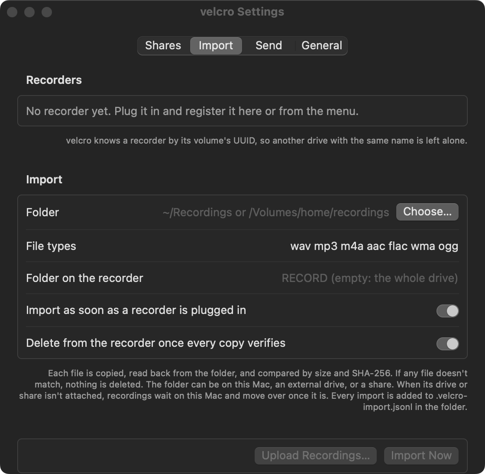
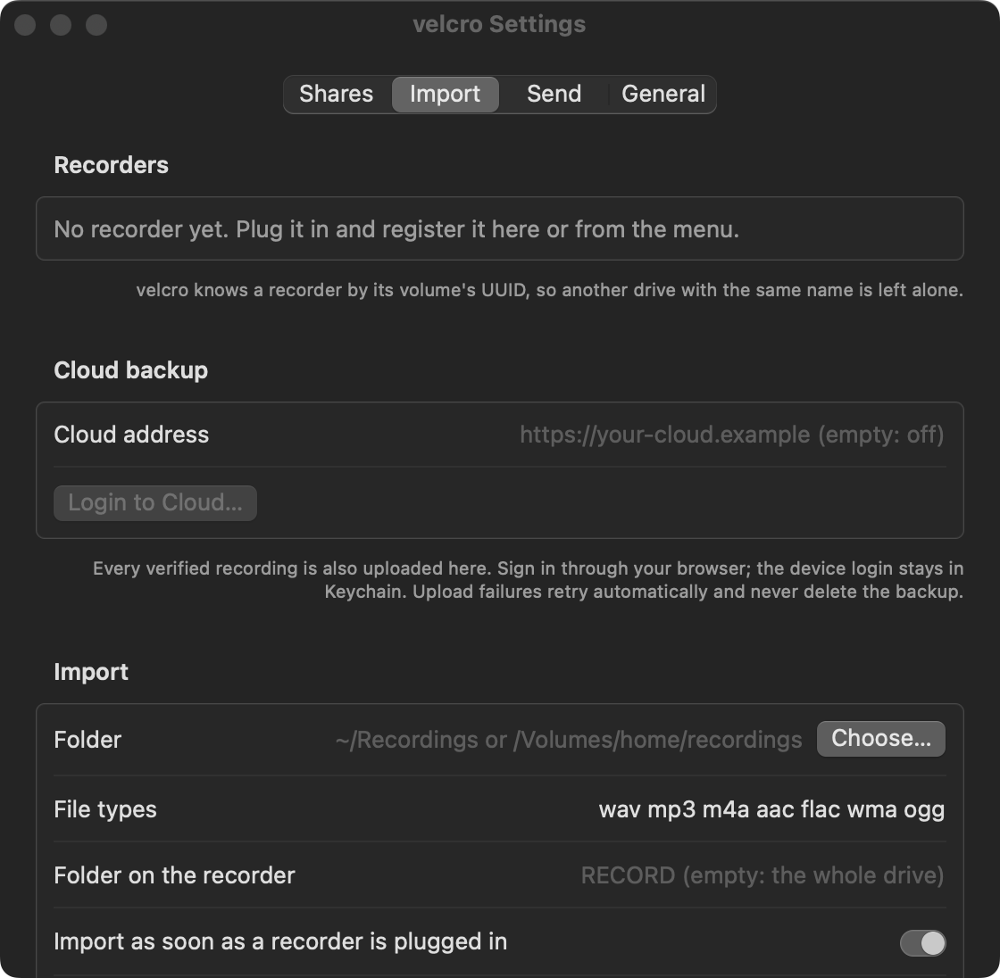

# 맥과 윈도우 녹음 클라우드 업로드 검증

기준일: 2026-11-09. 목표는 검증된 로컬 백업을 기기 로그인으로 클라우드에도 올리고, 중단 뒤 재개하며, 원본·백업을 보존하는 것이다. 클라우드 Worker·엔진·기존 서버 타이머는 변경하지 않는다.

## 확인한 범위

- [검증 결과 JSON](verification.json): Linux 142개(맥 전용 3개 제외), 맥 13 클라우드 20개·설치 3개, 실제 Windows 클라우드 20개·기존 가져오기 11개 통과.
- 맥 13의 실제 GUI 세션에서 Keychain 저장·조회·시험 항목 삭제, Windows Credential Manager에서도 저장·조회·시험 항목 삭제를 확인했다. 시험 값은 임의의 가짜 토큰이며 출력·파일에 남기지 않았다.
- Windows에서 실제 클라우드의 로그인 주소 조회 → 새 기기 코드 발급 → 승인 대기 응답까지 확인했다. 브라우저에서 사람이 승인하는 단계는 수행하지 않았다. 서버 기기 토큰은 다른 기기로 옮기지 않았다.
- [운영 무음 시험](production-silence.json): 생성한 1 MiB WAV를 실제 Worker에 올렸다. PUT 성공 뒤 완료 요청 직전에 연결 중단을 주입하고, 새 업로더에서 재개해 `received`를 확인했다. 확인된 조각은 다시 보내지 않았고, 다시 실행해도 업로드가 중복되지 않았으며 로컬 파일 SHA-256이 유지됐다. 실제 여러 조각 경계를 넘긴 시험은 아니다.
- 별도 에이전트가 전체 변경을 검토해 통과했다. 공유 폴더 기록 유실·파일명 재사용·늦게 도착한 상태 기록 경합을 회귀 시험으로 확인했다. 상태 행은 `cloud_status: true`로 구별하고 파일명·SHA가 같은 녹음에만 합친다.

## 남은 제한

210 MiB와 51 MiB 무음 WAV의 첫 50 MiB PUT가 소켓 계열 오류로 실패했다. 큰 파일 검증은 통과로 처리하지 않고 리드에게 넘겼다. 이후 PUT 시간 예산을 조각 크기에 비례하도록 조정했으나 대용량 운영 재시험은 아직 하지 않았다. Worker의 4 GiB 상한을 끝까지 시험했다는 증거도 없다.

구버전 `velcro-recordings`는 상태 행을 가져오기 행과 구별하지 않는다. 클라이언트를 켜기 전에 새 helper도 함께 배포해야 한다. 타이머 설정은 바꾸지 않는다. 업로드 끄기는 `velcro set upload.cloud`이며, 이미 저장한 클라우드 녹음과 로컬 백업은 유지한다.

## 화면

설치된 앱과 사용자 설정을 바꾸지 않고, 맥 13에서 빌드한 앱을 빈 시험 설정으로 실행해 Import 탭을 캡처했다. 화면을 열기 위한 실행 코드는 시험 사본에만 추가했다.

| 변경 전 | 변경 후 |
| --- | --- |
|  |  |

공개 PR 이미지: [변경 전](https://pub-fb48573f8b00457d85b6b229e8ff2fae.r2.dev/velcro/20261109/5fd0ccbc91563c48.png), [변경 후](https://pub-fb48573f8b00457d85b6b229e8ff2fae.r2.dev/velcro/20261109/e20dc409e404aba7.png). 개인 자료는 포함하지 않았다.

## 재현

```sh
python3 -m unittest discover -s tests
python3 scripts/test-cloud-client.py --cloud https://your-cloud.example --mib 1 --output result.json
```

운영 시험 스크립트만 `VELCRO_DEVICE_TOKEN`을 환경변수로 받는다. 제품 앱은 이 환경변수를 읽지 않고 OS 보안 저장소만 사용한다. 큰 파일 시험은 리드가 전송 실패 원인을 확인한 뒤 재개한다.
